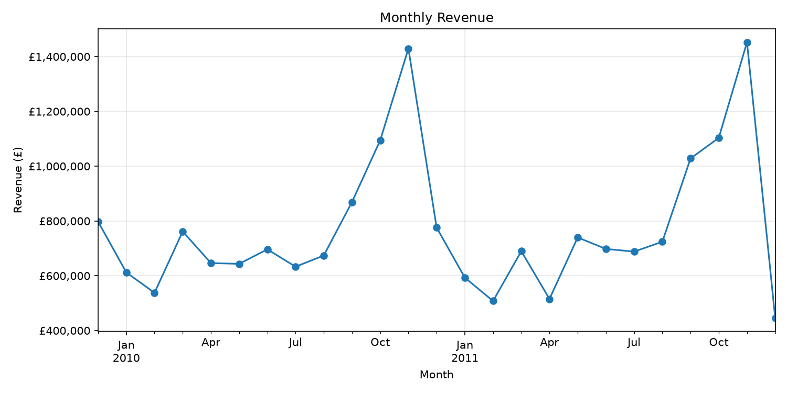
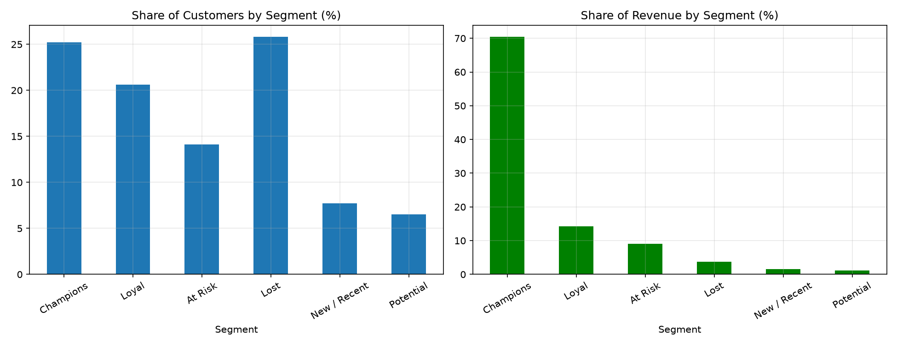
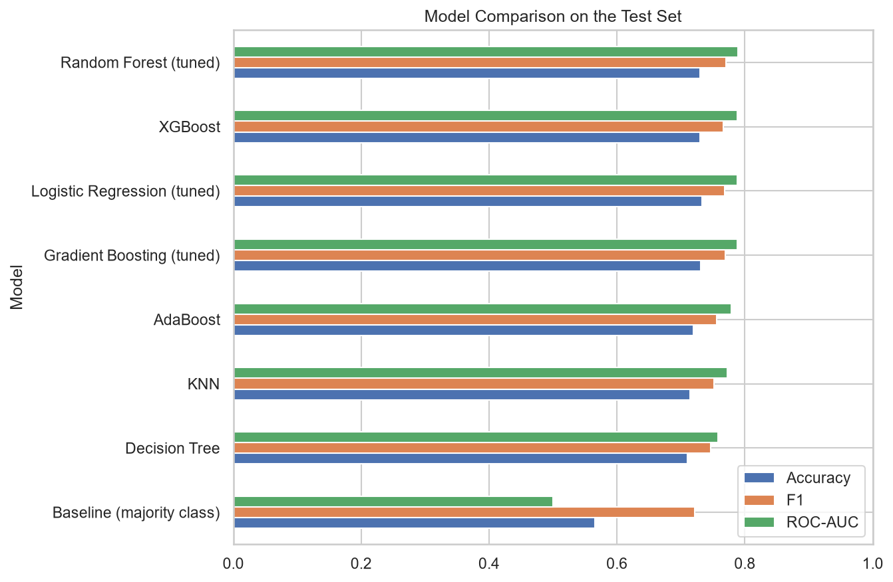
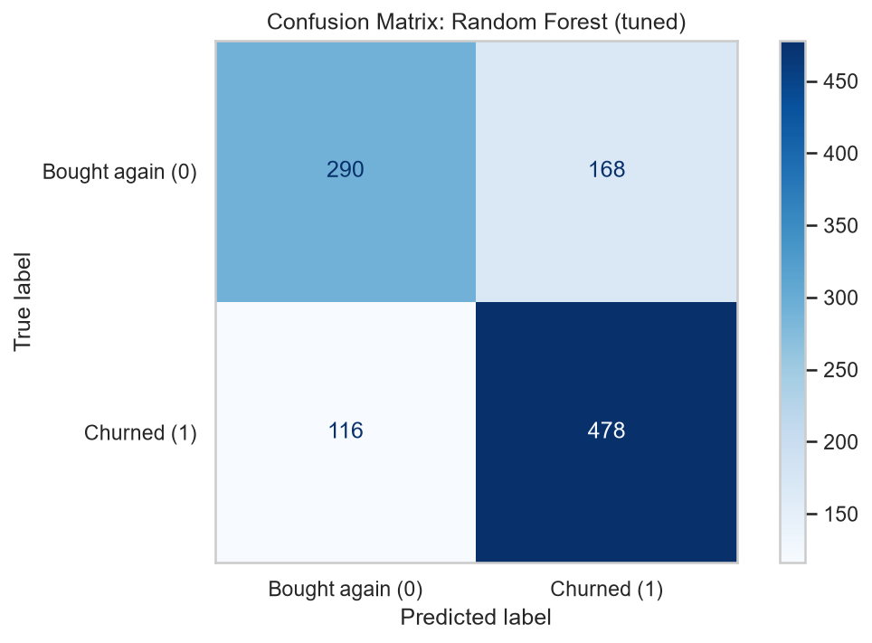
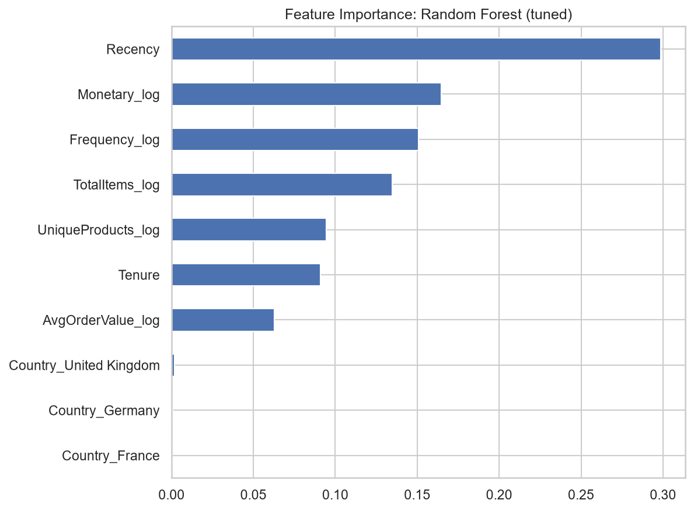

# Online Retail II: Sales Analysis, Customer Segmentation and Churn Prediction

An end-to-end data science project on about 1 million transactions from a UK-based online gift retailer.
It covers data cleaning, exploratory analysis, RFM customer segmentation, and a machine learning model that
predicts which customers will stop buying.

**Author:** Fathimathul Amana

## Highlights

- Cleaned **1,067,371 raw transaction rows** into **1,003,336 verified sales rows**, with every removal reconciled
- Found three data-entry errors that standard checks would miss, including a **£38,970 pricing error**
- Revenue of **£19.36M** across **39,512 orders**, with a strong **November peak** every year
- **RFM segmentation:** about **25% of customers (Champions) generate about 70% of revenue**
- **Churn model:** a tuned Random Forest predicts customer churn with about **73% accuracy and 0.79 ROC-AUC**,
  against a 56.5% baseline

## Business Questions

1. How large is the business, and how does revenue change over time?
2. Which products and countries drive revenue?
3. When do customers buy?
4. Who are the most valuable customers, and which are at risk of being lost?
5. Can we predict which customers will stop buying?

## Dataset

- **Source:** [Online Retail II, UCI Machine Learning Repository](https://archive.ics.uci.edu/dataset/502/online+retail+ii)
- **Period:** December 2009 to December 2011
- **Size:** 1,067,371 rows and 8 columns (Invoice, StockCode, Description, Quantity, InvoiceDate, Price, Customer ID, Country)
- The dataset is **not included** in this repository because of its size. Download it and place it at
  `data/online_retail_II.xlsx`.

## Repository Structure

```
online-retail-analysis/
├── notebooks/
│   ├── online_retail_analysis.ipynb   # cleaning, EDA, RFM segmentation
│   └── churn_prediction.ipynb         # churn prediction with machine learning
├── images/                            # charts used in this README
├── requirements.txt
└── README.md
```

## Notebook 1: Cleaning, EDA and RFM (`online_retail_analysis.ipynb`)

### Data cleaning

Every decision is documented in the notebook as observation, action, and reason.

- Removed **34,335 exact duplicate rows**
- Separated **cancellations** (19,104 rows), **non-product codes** such as postage, bank charges, test entries, gift vouchers,
  manual and bad-debt adjustments, and **zero-price stock adjustments** from real sales
- Standardised mixed-type columns (`Invoice`, `StockCode`) that caused silent filter errors
- Reconciled every step: 1,033,036 cleaned rows became 1,003,340 sales rows, and then 1,003,336 after outlier removal
- Found and removed **three data-entry errors**:
  - Two orders of 74,215 and 80,995 units that the same customer cancelled minutes later
  - A picnic basket invoice priced at £649.50 **per item** instead of £4.95, worth £38,970. Its reversal had been
    filtered out as a manual accounting entry, so the original sale had stayed in the data
- About 22.6% of sales rows have no Customer ID, so customer-level analysis covers identified customers only

### Key findings

| Area | Finding |
|---|---|
| Size | £19.36M revenue, 39,512 orders, average order value £489.94 (median £301.20) |
| Customer type | The mean order is well above the median, which suggests many customers are wholesale buyers |
| Seasonality | Revenue peaks in November (£1.43M in 2010, £1.45M in 2011). February is the weakest month in both years |
| Incomplete data | The drop in December 2011 is not real: the data ends on 9 December |
| Geography | The UK generates about 85% of revenue, followed by EIRE, the Netherlands, Germany, and France |
| Timing | Thursday is the strongest day, Saturday has almost no sales, and revenue peaks around midday |
| Products | The top product by revenue is the Regency Cakestand 3 Tier (£330,590) |



### RFM customer segmentation

Customers were scored on Recency, Frequency, and Monetary value (quintiles 1 to 5) and grouped into segments.

| Segment | Customers | Share of customers | Share of revenue |
|---|---|---|---|
| Champions | 1,476 | 25.2% | 70.4% |
| Loyal | 1,207 | 20.6% | 14.2% |
| At Risk | 828 | 14.1% | 9.0% |
| Lost | 1,509 | 25.8% | 3.7% |
| New / Recent | 450 | 7.7% | 1.5% |
| Potential | 382 | 6.5% | 1.2% |

The top 20% of customers by spending account for about 77% of revenue.



**Recommendations**
- **Champions:** protect them with early access to seasonal stock and dedicated service
- **At Risk:** previously frequent buyers who have gone quiet (about 368 days since the last order on average), so a win-back offer is worthwhile
- **Lost:** low value, so use only cheap, automated outreach
- Plan stock and promotions from September for the November peak

## Notebook 2: Churn Prediction (`churn_prediction.ipynb`)

### Problem

Using each customer's purchase history before **10 September 2011**, predict whether they will make **no purchase**
in the following ~90 days (churn). Features use only data before the cutoff, so the model never sees the future
(no data leakage).

### Method

- **Dataset:** 5,256 customers, one row per customer, with Recency, Tenure, Frequency, Monetary value, total items,
  unique products, average order value, and country group. 56.5% of customers churned.
- **Preprocessing:** log transform for skewed features, one-hot encoding of country, stratified 80/20 train/test split,
  scaling inside pipelines for Logistic Regression and KNN. Outlier customers were kept (they are real wholesale buyers).
- **Class balance:** the classes are nearly balanced, and an oversampling experiment did not help (F1 fell from 0.769 to 0.732),
  so the original data was used.
- **Models:** Logistic Regression, KNN, Decision Tree, Random Forest, AdaBoost, Gradient Boosting, and XGBoost,
  compared with 5-fold stratified cross-validation against a majority-class baseline.
- **Tuning:** GridSearchCV on Logistic Regression, Random Forest, and Gradient Boosting (XGBoost used fixed settings).

### Results (unseen test set)

| Model | Accuracy | Precision | Recall | F1 | ROC-AUC |
|---|---|---|---|---|---|
| Random Forest (tuned) | 0.730 | 0.740 | 0.805 | 0.771 | 0.789 |
| XGBoost | 0.730 | 0.749 | 0.785 | 0.766 | 0.788 |
| Gradient Boosting (tuned) | 0.731 | 0.747 | 0.791 | 0.769 | 0.788 |
| Logistic Regression (tuned) | 0.733 | 0.754 | 0.783 | 0.768 | 0.788 |
| AdaBoost | 0.720 | 0.744 | 0.768 | 0.756 | 0.779 |
| KNN | 0.714 | 0.737 | 0.768 | 0.752 | 0.773 |
| Decision Tree | 0.710 | 0.736 | 0.758 | 0.747 | 0.758 |
| Baseline (majority class) | 0.565 | 0.565 | 1.000 | 0.722 | 0.500 |





### What the results mean

- Every model clearly beats the baseline, so purchase history does carry signal about who will stop buying.
- The four best models (Random Forest, XGBoost, Gradient Boosting, and Logistic Regression) are within 0.001 ROC-AUC of
  each other, so the simple, explainable Logistic Regression performs about as well as the tree ensembles.
- **Recency** is the strongest predictor: customers who have been inactive for longer are more likely to churn.
  Spending and the number of orders matter next.
- The best model finds about **80% of churners** (recall 0.80) while being right about 74% of the time when it predicts churn.



## How to Run

1. Clone the repository and create a virtual environment:
   ```
   git clone https://github.com/fathimathulamana/online-retail-analysis.git
   cd online-retail-analysis
   python -m venv .venv
   .venv\Scripts\activate        # Windows
   pip install -r requirements.txt
   ```
2. Download the dataset and save it as `data/online_retail_II.xlsx`.
3. Run `notebooks/online_retail_analysis.ipynb` from top to bottom. It saves the cleaned data to `data/processed/`.
4. Run `notebooks/churn_prediction.ipynb` from top to bottom.

## Limitations

- About 22.6% of sales rows have no Customer ID, so customer-level results cover identified customers only.
- December 2011 is incomplete (data ends on 9 December).
- A few outlier decisions are judgement calls, documented in the notebook (for example one small picnic basket invoice).
- Churn is defined as "no purchase in 90 days" on a single cutoff date. Customers who buy quarterly can be labelled as
  churned, and results come from one train/test split.
- Only purchase history is used: there is no data on promotions, customer type, or competitors.

## Possible Improvements

- Test several cutoff dates and churn windows for a more robust estimate
- Add features such as gaps between orders, product categories, and the share of purchases in the Christmas season
- Tune the decision threshold for the business goal (for example, favour recall to catch more churners)
- Estimate the revenue at risk per customer

## Tools

Python, pandas, NumPy, Matplotlib, seaborn, scikit-learn, XGBoost, Jupyter Notebook (VS Code)

## References

- Online Retail II dataset, UCI Machine Learning Repository
- Pedregosa et al. (2011), *Scikit-learn: Machine Learning in Python*, Journal of Machine Learning Research
